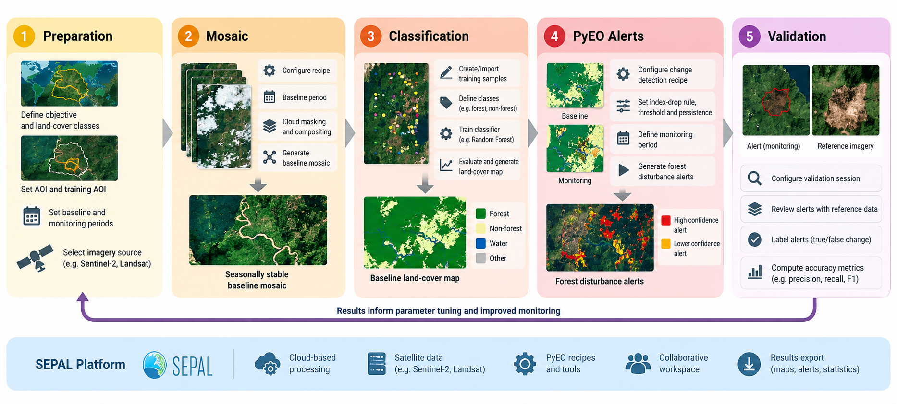

PyEO Forest Alerts - Interactive Workflow
==================
*Generate and validate forest disturbance alerts from optical satellite imagery using PyEO on SEPAL.*

Background
----------

Near real-time forest disturbance monitoring aims to identify recent changes in forest cover so that analysts and forest managers can review potential loss events promptly. Sentinel-2 provides multispectral optical observations at up to 10 m spatial resolution, with a nominal five-day revisit from the two-satellite constellation. Actual usable observations depend on cloud cover, acquisition availability and image quality.

**PyEO** stands for *Python for Earth Observation*. The PyEO forest alerts workflow combines satellite imagery, machine-learning land-cover classification and time-series change detection. Its implementation on `SEPAL <https://sepal.io/>`_ provides an interface for preparing imagery, mapping land cover, detecting candidate disturbances and reviewing alerts. The PyEO software was developed with forest-monitoring users, including partners in Kenya, and has been used in forest monitoring projects preceding AIM4Forests. See the `PyEO project documentation <https://clcr.github.io/pyeo/>`_.

This page describes the **PyEO Forest Alerts on SEPAL** workflow, illustrated by the **Mato Grosso, Brazil** pilot presented for AIM4Forests. The workflow is intended for detection and review of candidate forest disturbance events. An alert is not, by itself, independently verified evidence of deforestation or a statistically representative estimate of deforested area.

Methodology
-----------

Interactive Workflow Overview
-----------------------------

Click on a workflow stage to view its instructions,
screenshots, parameters and expected outputs.

.. grid:: 1 2 3 5
   :gutter: 2

   .. grid-item-card:: 1. Preparation
      :link: interactive-preparation
      :link-type: ref

      Define the study area, land-cover classes,
      imagery source and monitoring periods.

   .. grid-item-card:: 2. Mosaic
      :link: interactive-mosaic
      :link-type: ref

      Generate a cloud-masked baseline optical mosaic.

   .. grid-item-card:: 3. Classification
      :link: interactive-classification
      :link-type: ref

      Train a classifier and create the baseline
      land-cover map.

   .. grid-item-card:: 4. PyEO Alerts
      :link: interactive-alerts
      :link-type: ref

      Detect potential forest disturbance using
      change-detection parameters.

   .. grid-item-card:: 5. Validation
      :link: interactive-validation
      :link-type: ref

      Review forest alerts and export validated results.

Complete the workflow in five stages:

1. **Preparation:** define the area of interest (AOI), land-cover classes, baseline and monitoring periods, and imagery sources.
2. **Mosaic:** assemble a cloud-screened optical baseline mosaic.
3. **Classification:** train a supervised classifier using labelled samples to produce a baseline land-cover map.
4. **PyEO Alerts:** examine subsequent observations for changes in spectral vegetation condition and land-cover class, applying recurrence and persistence conditions to flag candidate forest disturbances.
5. **Validation:** review alert polygons against before/after imagery, record verdicts and supporting information, and export reviewed results.

   End-to-end PyEO workflow showing preparation, optical mosaic generation, land-cover classification, forest disturbance alert detection and validation.

The baseline classification defines the land cover from which transitions are monitored. The monitoring stage then identifies candidate transitions from selected forest classes to selected non-forest classes. The PyEO recipe also provides rules based on vegetation-index decline and the consistency of detections over time. These rules help distinguish persistent disturbances from isolated anomalous observations, although cloud artefacts, seasonal vegetation changes and classification errors can still produce false alerts.

.. note::

   The numerical settings and interface labels below document the **Brazil demonstration**, not universally recommended defaults. Adapt the AOI, dates, classes and thresholds to the monitoring region and the current SEPAL implementation. Some interface controls may differ between the test and production instances.

Supported imagery and software
------------------------------

The demonstrated workflow uses **Sentinel-2 surface-reflectance imagery** for optical mosaics and time-series analysis. The SEPAL mosaic interface also offers Landsat imagery as an alternative source. The presentation demonstrates optical imagery; it does not establish an operational Sentinel-1/SAR processing pathway for this particular PyEO SEPAL recipe.

The workflow uses the SEPAL processing interface, Google Earth Engine (GEE) assets for storing spatial inputs and outputs, and the **Deforestation Alert Analysis** SEPAL application for reviewing candidate alerts. The demonstration uses a **Random Forest** classifier for baseline land-cover mapping.

How-to guide
------------

.. _interactive-preparation:

Step 1 - Preparation
--------------------

Before generating forest disturbance alerts, define the study area,
monitoring objectives, land-cover classes, satellite imagery and
analysis periods.

This stage ensures that all required input datasets and monitoring
parameters are available before starting the PyEO workflow.

.. dropdown:: 1.1 Define the study area and monitoring parameters
   :open:

   **Objective:** Establish the study area, input datasets and
   monitoring configuration.

   The following parameters are used in the Brazil (Mato Grosso)
   pilot demonstration.

   .. list-table:: Brazil pilot site - monitoring parameters
      :header-rows: 1
      :widths: 35 65

      * - Parameter
        - Configuration
      * - Country / Region
        - Brazil, Mato Grosso State
      * - AOI centre
        - 15.0204° S, 59.1616° W
      * - Approximate AOI area
        - 30 km²
      * - Baseline period
        - 1 January 2019 to 1 January 2020
      * - Monitoring period
        - 1 May 2021 to 31 August 2021
      * - Imagery source
        - Sentinel-2
      * - Land-cover classes
        - Forest, Soil, Grassland, Dry Forest
      * - Planned FROM classes
        - Forest, Dry Forest
      * - Planned TO classes
        - Soil, Grassland
      * - Imagery correction
        - Surface Reflectance
      * - Maximum scene cloud cover
        - 25%
      * - Maximum per-pixel cloud probability
        - 45%

   **Required inputs:**

   * Area of Interest (AOI).
   * Training area and representative training samples.
   * Land-cover class definitions.
   * Baseline and monitoring periods.
   * Access to SEPAL and Google Earth Engine.

   .. note::

      The parameters shown above are specific to the Brazil pilot
      demonstration. Users should adapt these parameters according
      to their study area, vegetation characteristics and forest
      monitoring objectives.

.. dropdown:: 1.2 Create a recipe in SEPAL

   **Objective:** Access the processing recipes required for the
   PyEO forest alerts workflow.

   1. Log in to SEPAL.
   2. Navigate to the Process interface.
   3. Select the option to create a new recipe.
   4. Review the available processing recipes.

   The PyEO workflow uses three main processing recipes:

   * Optical mosaic.
   * Classification.
   * PyEO Forest Alerts.

   .. figure:: /_images/workflows/pyeo_alerts/preparation_02_create_recipe.png
      :alt: Create a new processing recipe in SEPAL
      :width: 100%
      :align: center

      Creating a new processing recipe in the SEPAL interface.

.. dropdown:: 1.3 Organise recipes into a project

   **Objective:** Organise the processing recipes associated with
   a particular study area within a single project.

   1. Create or select a project for the study area.
   2. Assign meaningful names to individual recipes.
   3. Organise the optical mosaic, classification and PyEO Forest
      Alerts recipes within the same project.

   .. figure:: /_images/workflows/pyeo_alerts/preparation_03_organise_recipes.png
      :alt: Organise processing recipes within a SEPAL project
      :width: 100%
      :align: center

      Organising processing recipes within a SEPAL project.

   .. tip::

      Include the study area, year and processing stage in recipe
      names to make them easier to identify and manage.

.. dropdown:: 1.4 Select the study area project

   1. Open the Projects list.
   2. Select the relevant project.
   3. Verify that the associated processing recipes are displayed.

   In this demonstration, the Brazil Mato Grosso project is used.

   .. figure:: /_images/workflows/pyeo_alerts/preparation_04_select_project.png
      :alt: Select the Brazil Mato Grosso project in SEPAL
      :width: 100%
      :align: center

      Selecting the Brazil pilot project and its associated recipes.

.. admonition:: Expected output
   :class: tip

   A defined study area, monitoring objectives, land-cover classes,
   training dataset, analysis periods and an organised SEPAL project.

.. button-ref:: interactive-mosaic
   :ref-type: ref
   :color: primary
   :outline:

   Next step: Mosaic

.. _interactive-mosaic:

Step 2 - Mosaic
---------------

Generate the baseline optical mosaic using the
selected imagery, cloud masking and compositing
settings.

.. dropdown:: 2.1 Select the Area of Interest (AOI)
   :open:

   **Objective:** Define the geographical area for
   generating the baseline optical mosaic.

   1. Open the Optical Mosaic recipe in SEPAL.
   2. Navigate to the AOI panel.
   3. Select **EE table** as the AOI source.
   4. Choose the Brazil AOI from your Earth Engine assets.
   5. Verify that the AOI boundary appears on the map.

   .. image:: /_images/workflows/pyeo_alerts/mosaic_01_select_aoi.png
      :alt: SEPAL optical mosaic recipe - select Brazil AOI
      :width: 90%
      :align: center

   .. note::

      The Brazil AOI is used as the demonstration area
      in this walkthrough. Users should select their
      own AOI for other study regions.

.. dropdown:: 2.2 Select the Baseline Dates

   **Objective:** Define the reference period for
   creating the baseline optical mosaic.

   1. Open the date selection panel.
   2. Set the target date to **2 July 2019**.
   3. Use the baseline window from
      **1 January 2019 to 1 January 2020**.
   4. Do not add extra past or future seasons for
      this demonstration.

   .. image:: /_images/workflows/pyeo_alerts/mosaic_02_baseline_date.png
      :alt: SEPAL optical mosaic recipe - baseline date selection
      :width: 90%
      :align: center

   .. note::

      This example uses imagery from the 2019 baseline
      period to represent the reference land-cover state.

.. dropdown:: 2.3 Choose the Imagery Source

   **Objective:** Select the satellite imagery used
   to construct the baseline mosaic.

   1. Open the Sources panel.
   2. Review the available Landsat and Sentinel-2
      datasets.
   3. Select **Sentinel-2**.
   4. Set the maximum scene cloud cover to **25%**
      for the Brazil demonstration.

   .. image:: /_images/workflows/pyeo_alerts/mosaic_03_imagery_source.png
      :alt: SEPAL optical mosaic recipe - Sentinel-2 source
      :width: 90%
      :align: center

   .. note::

      The cloud-cover threshold filters scenes before
      compositing. It is separate from pixel-level
      cloud masking.

.. dropdown:: 2.4 Set Corrections and Cloud Masking

   **Objective:** Configure imagery corrections,
   cloud masking and compositing.

   1. Select **Surface Reflectance (SR)**.
   2. Keep orbit overlap and apply quick removal
      of tile overlap.
   3. Configure the SEPAL cloud score and
      Sentinel-2 Cloud Score+ masking options.
   4. Set the pixel-level cloud threshold according
      to the Brazil pilot configuration.
   5. Select the **Medoid** compositing method.
   6. Generate the 2019 baseline mosaic.
   7. Export the resulting mosaic as an Earth Engine
      asset for the classification stage.

   .. image:: /_images/workflows/pyeo_alerts/mosaic_04_cloud_masking.png
      :alt: SEPAL optical mosaic corrections and cloud masking
      :width: 90%
      :align: center

   .. note::

      The Brazil pilot parameter summary specifies a
      maximum per-pixel cloud probability of 45%.
      Confirm the corresponding control and its
      interpretation in the SEPAL interface.

   **Expected output:** A seasonally stable 2019
   Sentinel-2 baseline mosaic covering the selected AOI.

.. button-ref:: interactive-preparation
   :ref-type: ref
   :color: secondary
   :outline:

   Previous step: Preparation

.. button-ref:: interactive-classification
   :ref-type: ref
   :color: primary
   :outline:

   Next step: Classification

.. _interactive-classification:

Step 3 - Classification
-----------------------

The classification stage generates a baseline land-cover map using
the optical mosaic produced in the previous stage and representative
training samples.

A supervised machine-learning classifier is trained to distinguish
between different land-cover classes. The trained classifier is
subsequently used in the PyEO Forest Alerts workflow to identify
potential land-cover changes during the monitoring period.

.. dropdown:: 3.1 Select the images to classify
   :open:

   **Objective:** Select the baseline imagery required for
   supervised land-cover classification.

   1. Navigate to the SEPAL Process interface.
   2. Create a new Classification recipe.
   3. Open the image selection panel (IMG).
   4. Select the 2019 baseline optical mosaic generated in
      the previous stage.
   5. Verify that the selected imagery covers the Area of
      Interest (AOI).

   The linked map panes allow users to compare the baseline
   imagery, training points, classified map and classification
   confidence.

   .. figure:: /_images/workflows/pyeo_alerts/classification_01_select_images.png
      :alt: Select baseline imagery for land-cover classification
      :width: 100%
      :align: center

      Selecting the 2019 baseline optical mosaic as the input
      for land-cover classification.

   .. note::

      The baseline imagery should correspond to the baseline
      period and study area defined during the Preparation
      and Mosaic stages.

.. dropdown:: 3.2 Define the land-cover classes

   **Objective:** Establish the land-cover categories used
   during supervised classification.

   1. Open the Legend panel (LEG).
   2. Add the required land-cover classes.
   3. Assign a unique numerical value to each class.
   4. Assign a distinct colour to each class.
   5. Verify that all required classes are included.

   The Brazil pilot demonstration uses four land-cover classes:

   .. list-table:: Brazil pilot land-cover classes
      :header-rows: 1
      :widths: 35 65

      * - Land-cover class
        - Description
      * - Forest
        - Areas characterised by forest vegetation.
      * - Soil
        - Areas dominated by exposed or bare soil.
      * - Grassland
        - Areas dominated by grass or herbaceous vegetation.
      * - Dry Forest
        - Areas identified as dry forest vegetation.

   .. figure:: /_images/workflows/pyeo_alerts/classification_02_define_classes.png
      :alt: Define land-cover classes using the SEPAL legend builder
      :width: 100%
      :align: center

      Defining the land-cover classes, numerical values and
      associated colours using the legend builder.

   .. important::

      The numerical class values defined in the legend must
      correspond to the class values in the training dataset.

      Inconsistent class values can result in incorrect training
      labels and unreliable classification results.

.. dropdown:: 3.3 Add the training data

   **Objective:** Provide representative reference samples
   for training the land-cover classifier.

   1. Open the Training data panel (TRN).
   2. Select **Add** to introduce a training data source.
   3. Import an existing training dataset or create training
      points manually using the SEPAL interface.
   4. Verify that the training points appear on the map.
   5. Check that each training point is assigned to the
      appropriate land-cover class.

   In the Brazil pilot demonstration, the existing
   ``BrazilTrainingPoints.csv`` dataset is used alongside
   training points collected through the interface.

   .. figure:: /_images/workflows/pyeo_alerts/classification_03_training_data.png
      :alt: Import and inspect land-cover classification training points
      :width: 100%
      :align: center

      Adding reference training points and inspecting their
      spatial distribution and assigned land-cover classes.

   .. tip::

      Training samples should represent the variability of
      each land-cover class across the study area.

      Review the spatial distribution and quality of the
      training samples before generating the classification.

   .. important::

      If the Training data panel (TRN) cannot be opened,
      first ensure that the input imagery (IMG) and the
      land-cover legend (LEG) have been configured.

.. dropdown:: 3.4 Configure the machine-learning classifier

   **Objective:** Train a supervised machine-learning classifier
   using the baseline imagery and labelled training samples.

   1. Open the classifier configuration panel.
   2. Review the available classification algorithms.
   3. Select **Random Forest**.
   4. Configure the classifier parameters.
   5. Generate the baseline land-cover classification.

   The Brazil pilot demonstration uses a Random Forest
   classifier with 25 trees.

   .. list-table:: Example classifier configuration
      :header-rows: 1
      :widths: 40 60

      * - Parameter
        - Configuration
      * - Classification algorithm
        - Random Forest
      * - Number of trees
        - 25
      * - Input imagery
        - 2019 baseline optical mosaic
      * - Training data
        - Labelled land-cover training points
      * - Output
        - Baseline land-cover classification

   .. figure:: /_images/workflows/pyeo_alerts/classification_04_classifier.png
      :alt: Configure the Random Forest classifier in SEPAL
      :width: 100%
      :align: center

      Configuring the Random Forest classifier and its
      associated machine-learning parameters.

   .. note::

      Random Forest combines multiple decision trees to
      predict the land-cover class of each pixel.

      Classifier parameters, including the number of trees,
      variables per split and bag fraction, can be adjusted
      according to the training dataset and study area.

      Other classification algorithms, such as Gradient Tree
      Boost, may also be explored.

.. dropdown:: 3.5 Review the classified map

   **Objective:** Assess the visual quality and plausibility
   of the generated baseline land-cover classification.

   Use the linked map panes to compare:

   * Baseline optical imagery.
   * Training points.
   * Predicted land-cover classes.
   * Classification confidence.

   1. Move the cursor across different land-cover types.
   2. Inspect the predicted class at individual locations.
   3. Review the associated classification confidence.
   4. Identify potentially misclassified areas.
   5. Compare the results with the baseline optical imagery.

   .. figure:: /_images/workflows/pyeo_alerts/classification_05_review_map.png
      :alt: Compare the baseline imagery, classified map and confidence
      :width: 100%
      :align: center

      Reviewing the baseline classification and pixel-level
      classification confidence using linked map panes.

   In the illustrated example, the selected pixel is
   classified as Forest with a confidence value of 87%.

   .. important::

      Classification confidence represents the confidence
      associated with an individual prediction.

      It should not be interpreted as an independent
      estimate of overall classification accuracy.

      Independent reference samples are required for a
      formal classification accuracy assessment.

.. dropdown:: 3.6 Inspect individual training points

   **Objective:** Identify potentially incorrect or
   unrepresentative training samples.

   1. Select an individual training point on the map.
   2. Inspect its geographical coordinates.
   3. Review its currently assigned land-cover class.
   4. Compare the assigned class with the reference imagery.
   5. Identify incorrectly labelled or misplaced points.

   .. figure:: /_images/workflows/pyeo_alerts/classification_06_inspect_point.png
      :alt: Inspect the location and class of an individual training point
      :width: 100%
      :align: center

      Inspecting an individual training point and its
      assigned land-cover class.

   .. tip::

      Particular attention should be given to training
      points located near land-cover boundaries or in
      heterogeneous areas, where class assignment may
      be uncertain.

.. dropdown:: 3.7 Confirm or correct the training classes

   **Objective:** Improve the quality of the training dataset
   and the resulting baseline classification.

   1. Select a training point requiring correction.
   2. Assign the appropriate land-cover class.
   3. Remove incorrectly placed training points where necessary.
   4. Review the remaining training samples.
   5. Update the classification after making corrections.
   6. Inspect the revised classification and confidence layers.

   .. figure:: /_images/workflows/pyeo_alerts/classification_07_correct_class.png
      :alt: Correct the land-cover class assigned to a training point
      :width: 100%
      :align: center

      Correcting the land-cover class assigned to an
      individual training point.

   Repeat the review and correction process where necessary
   until the baseline classification is suitable for the
   monitoring objectives.

   **Prepare the classification for PyEO Forest Alerts:**

   * Save the completed classification recipe.
   * If required, retrieve the classified output as an
     Earth Engine asset.
   * Verify that the classification can be selected in the
     PyEO Forest Alerts recipe.
   * Ensure that the land-cover class definitions remain
     consistent with the planned change detection rules.

   .. note::

      The classification generated during this stage
      provides the baseline land-cover information for
      detecting changes during the monitoring period.

.. admonition:: Expected output
   :class: tip

   A baseline land-cover classification generated using
   representative training samples and a trained
   machine-learning classifier.

   The classification and its associated recipe or
   compatible Earth Engine asset are ready for use in
   the PyEO Forest Alerts stage.

.. button-ref:: interactive-mosaic
   :ref-type: ref
   :color: secondary
   :outline:

   Previous step: Mosaic

.. button-ref:: interactive-alerts
   :ref-type: ref
   :color: primary
   :outline:

   Next step: PyEO Alerts

.. _interactive-alerts:

Step 4 - PyEO Alerts
--------------------

The PyEO Forest Alerts stage identifies potential forest
disturbances by analysing land-cover changes across a satellite
image time series.

The baseline land-cover classification and trained classifier
generated in the previous stage provide the reference information
for detecting changes during the monitoring period.

Users can configure the monitoring dates, imagery pre-processing
options, land-cover transitions and change detection thresholds
according to their forest monitoring objectives.

.. dropdown:: 4.1 Create the PyEO Forest Alerts recipe
   :open:

   **Objective:** Configure the forest disturbance monitoring
   recipe and establish the visualisation environment.

   1. Navigate to the SEPAL Process interface.
   2. Create a new PyEO Forest Alerts recipe.
   3. Assign an appropriate name to the recipe.
   4. Open the Layers panel.
   5. Arrange the relevant imagery and analysis layers using
      the multi-pane map layout.

   The multi-pane layout enables direct comparison between
   the baseline imagery, baseline classification and forest
   change detection outputs.

   Additional SEPAL recipes or Earth Engine assets can be
   included using the **Add** option.

   .. figure:: /_images/workflows/pyeo_alerts/alerts_01_compare_layers.png
      :alt: Four-pane map layout in the PyEO Forest Alerts recipe
      :width: 100%
      :align: center

      Configuring the multi-pane map layout for comparing
      baseline imagery and forest change detection layers.

   .. tip::

      Use consistent map locations and zoom levels when
      comparing different layers to facilitate interpretation.

.. dropdown:: 4.2 Select the baseline classification

   **Objective:** Establish the baseline land-cover reference
   for the forest change detection analysis.

   1. Open the baseline classification selection panel.
   2. Select the classification generated during Step 3.
   3. Choose the appropriate SEPAL classification recipe or
      compatible Earth Engine asset.
   4. Verify that the classification corresponds to the
      selected study area and baseline period.

   In the Brazil pilot demonstration, the 2019 baseline
   land-cover classification is used as the reference for
   subsequent time-series analysis.

   .. figure:: /_images/workflows/pyeo_alerts/alerts_02_baseline_classification.png
      :alt: Select the baseline land-cover classification for PyEO
      :width: 100%
      :align: center

      Selecting the baseline classification generated during
      the previous stage of the workflow.

   .. important::

      Ensure that the selected classification is compatible
      with the PyEO Forest Alerts recipe and that the
      associated class definitions are correct.

      Errors in the baseline classification may propagate
      into the forest change detection results.

.. dropdown:: 4.3 Configure the baseline and monitoring periods

   **Objective:** Define the temporal extent of the forest
   disturbance monitoring analysis.

   The baseline period is inherited from the selected
   classification recipe or compatible asset.

   The monitoring period is defined by the user and determines
   the time interval over which forest disturbances are detected.

   .. list-table:: Brazil pilot temporal configuration
      :header-rows: 1
      :widths: 40 60

      * - Parameter
        - Configuration
      * - Baseline start date
        - 1 January 2019
      * - Baseline end date
        - 1 January 2020
      * - Monitoring start date
        - 1 May 2021
      * - Monitoring end date
        - 31 August 2021

   .. figure:: /_images/workflows/pyeo_alerts/alerts_03_date_ranges.png
      :alt: Configure the baseline and monitoring date ranges
      :width: 100%
      :align: center

      Reviewing the inherited baseline period and configuring
      the monitoring period for forest disturbance detection.

   .. note::

      The baseline represents the reference land-cover
      conditions against which subsequent observations
      are compared.

.. dropdown:: 4.4 Select the monitoring dates

   **Objective:** Specify the start and end dates of the
   monitoring period.

   1. Open the monitoring date selection interface.
   2. Select the monitoring start date.
   3. Select the monitoring end date.
   4. Confirm the selected date range.
   5. Verify that the monitoring period corresponds to the
      intended forest monitoring exercise.

   .. figure:: /_images/workflows/pyeo_alerts/alerts_04_monitoring_dates.png
      :alt: Select monitoring dates using the calendar interface
      :width: 100%
      :align: center

      Selecting the monitoring start and end dates using
      the calendar interface.

   .. tip::

      Consider satellite observation availability, cloud
      contamination, seasonal vegetation dynamics and the
      required reporting frequency when selecting the
      monitoring period.

      A monitoring period should provide sufficient usable
      observations to identify persistent land-cover changes.

.. dropdown:: 4.5 Configure imagery pre-processing options

   **Objective:** Improve the quality and consistency of
   satellite observations used for forest change detection.

   Open the imagery processing configuration panel and
   review the available pre-processing options.

   Relevant settings include:

   * Surface reflectance corrections.
   * Orbit overlap handling.
   * Tile overlap handling.
   * SEPAL cloud score.
   * Sentinel-2 Cloud Score+.

   .. figure:: /_images/workflows/pyeo_alerts/alerts_05_preprocessing.png
      :alt: Configure satellite imagery pre-processing and cloud masking
      :width: 100%
      :align: center

      Configuring imagery corrections, overlap handling
      and cloud masking for the monitoring time series.

   .. important::

      Clouds, haze and cloud shadows can introduce spectral
      changes that may be incorrectly interpreted as
      land-cover disturbances.

      Appropriate cloud masking and imagery pre-processing
      help reduce false detections.

.. dropdown:: 4.6 Configure the forest change detection rules

   **Objective:** Establish the conditions under which
   observed land-cover changes are identified as potential
   forest disturbance alerts.

   Open the detection options panel and configure the
   relevant PyEO change detection parameters.

   .. list-table:: Forest change detection parameters
      :header-rows: 1
      :widths: 35 65

      * - Parameter
        - Purpose
      * - Minimum NDVI drop
        - Specifies the minimum reduction in vegetation
          greenness required when the NDVI-drop rule is enabled.
      * - Minimum cumulative detections
        - Specifies the minimum number of detected changes
          required by the detection rule.
      * - Detection consistency
        - Specifies the required consistency of detected
          changes across the relevant observations.

   .. figure:: /_images/workflows/pyeo_alerts/alerts_06_detection_rules.png
      :alt: Configure PyEO forest disturbance detection thresholds
      :width: 100%
      :align: center

      Configuring vegetation-index change, cumulative
      detection and consistency thresholds.

   **Understanding the detection parameters**

   NDVI, or Normalised Difference Vegetation Index,
   describes vegetation greenness using red and
   near-infrared reflectance.

   A reduction in NDVI may indicate vegetation disturbance,
   although seasonal changes, agricultural activities and
   other environmental factors can also cause reductions.

   Repeated detections and consistency thresholds help
   distinguish persistent disturbances from temporary
   fluctuations in the satellite observations.

   .. note::

      Detection thresholds should be selected according
      to the monitoring objectives, vegetation characteristics,
      satellite observation availability and local
      environmental conditions.

      Thresholds suitable for one study area may not
      necessarily be appropriate for another.

.. dropdown:: 4.7 Define the land-cover class transitions

   **Objective:** Specify which land-cover transitions
   should trigger forest disturbance alerts.

   The PyEO Forest Alerts recipe uses the baseline
   classification to identify the land-cover classes
   from which and to which changes are monitored.

   1. Open the class transition configuration panel.
   2. Select the relevant FROM classes.
   3. Select the relevant TO classes.
   4. Verify that the selected classes correspond to
      the baseline classification legend.

   The illustrated Brazil Alerts configuration uses:

   .. list-table:: Example forest disturbance transitions
      :header-rows: 1
      :widths: 40 60

      * - Transition category
        - Selected classes
      * - FROM classes
        - Forest
      * - TO classes
        - Soil, Grassland

   .. figure:: /_images/workflows/pyeo_alerts/alerts_07_class_transitions.png
      :alt: Define FROM and TO land-cover classes for forest alerts
      :width: 100%
      :align: center

      Configuring the land-cover transitions used to
      identify potential forest disturbances.

   .. note::

      Additional forest classes, such as Dry Forest,
      may be included where appropriate to the monitoring
      objectives and baseline classification.

      For monitoring forest restoration or regeneration,
      different transition rules may be required.

   .. important::

      The selected class transitions must be consistent
      with the numerical class values and land-cover
      definitions established during classification.

.. dropdown:: 4.8 Inspect the change detection layers

   **Objective:** Examine the spatial and temporal
   characteristics of detected forest disturbances.

   Use the linked map panes to compare:

   * Baseline optical mosaic.
   * Baseline land-cover classification.
   * Total detected changes.
   * First Change Date (FCD).

   Move the cursor to a location of interest and
   inspect the corresponding values in the change
   detection layers.

   .. figure:: /_images/workflows/pyeo_alerts/alerts_08_change_layers.png
      :alt: Inspect total detected changes and first change date
      :width: 100%
      :align: center

      Inspecting the number of detected changes and
      first change date at an individual pixel.

   In the illustrated Brazil example, the selected
   pixel has the following values:

   .. list-table:: Example pixel-level change information
      :header-rows: 1
      :widths: 50 50

      * - Parameter
        - Value
      * - Total detected changes
        - 14
      * - First Change Date
        - 13 June 2021

   .. note::

      The total detected changes represent repeated
      change detections at the selected location.

      They should not be interpreted as the number
      of separate deforestation events.

.. dropdown:: 4.9 Compare change detection at another location

   **Objective:** Examine spatial differences in
   the timing and recurrence of detected disturbances.

   1. Move the cursor to another location within
      the detected disturbance area.
   2. Inspect the total detected changes.
   3. Review the First Change Date.
   4. Compare the values with those observed at
      other locations.

   .. figure:: /_images/workflows/pyeo_alerts/alerts_09_compare_location.png
      :alt: Compare change detection information at another pixel
      :width: 100%
      :align: center

      Comparing forest disturbance detection values
      at a different location.

   In the second illustrated example, the selected
   pixel has the following values:

   .. list-table:: Second example of pixel-level change information
      :header-rows: 1
      :widths: 50 50

      * - Parameter
        - Value
      * - Total detected changes
        - 9
      * - First Change Date
        - 23 July 2021

   Comparing multiple locations can help identify
   differences in the spatial and temporal progression
   of forest disturbance.

.. dropdown:: 4.10 Review the change-report layers

   **Objective:** Interpret the different information
   layers generated by the PyEO Forest Alerts recipe.

   The change report provides multiple layers describing
   the detected changes during the monitoring period.

   Relevant layers include:

   .. list-table:: Selected PyEO change-report layers
      :header-rows: 1
      :widths: 35 65

      * - Information layer
        - Interpretation
      * - Total detected changes
        - Number of change detections at a location.
      * - First Change Date (FCD)
        - Date of the first detected change.
      * - Repeatability
        - Information describing the recurrence or
          consistency of detected changes.
      * - Binary decision map
        - Locations satisfying the configured
          change detection decision rules.
      * - FCD decision map
        - First change dates for locations satisfying
          the change detection decision rules.

   .. figure:: /_images/workflows/pyeo_alerts/alerts_10_change_report.png
      :alt: Compare PyEO change-report and repeatability layers
      :width: 100%
      :align: center

      Comparing the repeatability and First Change
      Date layers within the PyEO change report.

   The First Change Date layer can be used to examine
   the temporal progression of detected disturbance
   across the study area.

   In the Brazil demonstration, changes in the FCD
   map illustrate the progression of forest clearance
   during June and July 2021.

   .. important::

      A detected forest disturbance alert is not
      necessarily a confirmed deforestation event.

      The generated alerts should be reviewed using
      supporting reference imagery during the
      Validation stage.

.. dropdown:: 4.11 Select the change-report bands for retrieval

   **Objective:** Prepare the forest change detection
   outputs for export and subsequent validation.

   1. Open the **Retrieve** interface.
   2. Review the available change-report bands.
   3. Select the bands required for subsequent analysis.
   4. Configure the spatial scale of the exported data.

   For the Sentinel-2 Brazil demonstration, the
   export spatial scale is set to 10 metres.

   .. figure:: /_images/workflows/pyeo_alerts/alerts_11_retrieve_bands.png
      :alt: Select PyEO forest change-report bands for export
      :width: 100%
      :align: center

      Selecting the change-report information bands
      and configuring the spatial export scale.

   **Required bands for the subsequent validation stage**

   .. list-table:: PyEO validation input bands
      :header-rows: 1
      :widths: 50 50

      * - Band name
        - Purpose
      * - ``binary_timeseries_decision``
        - Identifies locations satisfying the
          change detection decision rules.
      * - ``fcd_decision_map``
        - Provides the first detected change date
          for locations satisfying the decision rules.

   .. important::

      Ensure that both required bands are included
      in the exported Earth Engine asset.

      These bands will be selected when configuring
      the Deforestation Alert Analysis application
      during Step 5.

.. dropdown:: 4.12 Export the forest alerts to Earth Engine

   **Objective:** Save the generated forest disturbance
   alert map for use in the validation application.

   1. Select Earth Engine as the export destination.
   2. Set the asset type to **Image**.
   3. Enter an appropriate asset name.
   4. Select the appropriate asset destination.
   5. Review the sharing configuration.
   6. Click **Retrieve** to initiate the export.
   7. Wait for the export process to complete.
   8. Verify that the asset is available in Earth Engine.

   .. list-table:: Example alert export configuration
      :header-rows: 1
      :widths: 40 60

      * - Parameter
        - Configuration
      * - Export destination
        - Google Earth Engine
      * - Asset type
        - Image
      * - Spatial scale
        - 10 metres
      * - Sharing
        - Private
      * - Example asset name
        - Forest_alerts_Brazil_4m

   .. figure:: /_images/workflows/pyeo_alerts/alerts_12_export_asset.png
      :alt: Export the PyEO forest alert map as an Earth Engine asset
      :width: 100%
      :align: center

      Exporting the forest disturbance alert map
      as a Google Earth Engine image asset.

   .. tip::

      Use descriptive asset names that include the
      study area and monitoring period.

      Verify that the exported asset contains all
      required bands before starting the validation
      workflow.

   .. important::

      The exported alert asset is the primary input
      for the Deforestation Alert Analysis application.

      Ensure that the export has completed successfully
      and that the validation operator has the required
      permissions to access the asset.

.. admonition:: Expected output
   :class: tip

   A forest disturbance alert map generated from the
   satellite image time series using the configured
   land-cover transitions and change detection rules.

   The exported Earth Engine asset contains the
   required forest change detection information,
   including the binary decision and First Change
   Date decision bands.

   The alert asset is ready for review and validation
   in the Deforestation Alert Analysis application.

.. button-ref:: interactive-classification
   :ref-type: ref
   :color: secondary
   :outline:

   Previous step: Classification

.. button-ref:: interactive-validation
   :ref-type: ref
   :color: primary
   :outline:

   Next step: Validation

.. _interactive-validation:

Step 5 - Validation
-------------------

The Validation stage enables users to manually review,
interpret and verify potential forest disturbance alerts
generated during the PyEO Forest Alerts stage.

The Deforestation Alert Analysis application in SEPAL
provides an interactive environment for examining satellite
imagery, reviewing detected disturbance areas, recording
validation verdicts and exporting reviewed alert products.

The application uses the forest disturbance alert asset
exported to Google Earth Engine during Step 4.

The validation workflow consists of eight main configuration
and evaluation steps:

1. Area of Interest (AOI).
2. Alerts.
3. Optional layers.
4. Period.
5. Download and harmonize.
6. Integrate and vectorize.
7. Questionnaire.
8. Evaluation.

.. dropdown:: 5.1 Launch the Deforestation Alert Analysis application
   :open:

   **Objective:** Start the validation application and
   establish a project for reviewing forest disturbance
   alerts.

   1. Log in to SEPAL.
   2. Open the SEPAL console.
   3. Start a suitable compute instance.
   4. Navigate to the application menu using the spanner
      icon on the left-hand side.
   5. Locate and launch **Deforestation Alert Analysis**.
   6. Wait for the application to initialise.

   The Brazil pilot demonstration uses a c4 compute
   instance.

   .. figure:: /_images/workflows/pyeo_alerts/validation_01_launch_app.png
      :alt: Launch the Deforestation Alert Analysis application in SEPAL
      :width: 100%
      :align: center

      Launching the Deforestation Alert Analysis application
      from the SEPAL application menu.

   .. note::

      The application runs within the SEPAL computing
      environment and requires an active compute instance.

      Application initialisation may take a few minutes.

   **Open or create a validation project**

   When no project is currently open, the application
   provides options to:

   * Create a new project.
   * Manage existing projects.
   * Import a project.

   .. figure:: /_images/workflows/pyeo_alerts/validation_02_open_project.png
      :alt: Open or create a forest alert validation project
      :width: 100%
      :align: center

      Opening or creating a validation project within
      the Deforestation Alert Analysis application.

   **Manage existing projects**

   Select **Manage projects** to review previously
   created validation projects.

   Existing projects can be reopened to continue
   earlier validation activities.

   .. figure:: /_images/workflows/pyeo_alerts/validation_03_manage_projects.png
      :alt: Manage existing forest alert validation projects
      :width: 100%
      :align: center

      Managing existing validation projects for the
      Brazil, Ghana and Kenya demonstration sites.

   **Create a new validation project**

   1. Select **New project**.
   2. Enter a descriptive project name.
   3. Click **Create**.
   4. Wait for the validation configuration interface
      to open.

   The Brazil demonstration uses the project name
   ``Brazil_MatoGrosso_4mnths``.

   .. figure:: /_images/workflows/pyeo_alerts/validation_04_create_project.png
      :alt: Create a new Brazil Mato Grosso validation project
      :width: 100%
      :align: center

      Creating a new validation project for the
      Brazil Mato Grosso demonstration.

   Creating a project opens the eight-step validation
   configuration interface.

.. dropdown:: 5.2 AOI - Select the area to monitor

   **Objective:** Define the geographical area within
   which forest disturbance alerts will be reviewed.

   This corresponds to Step 1 of 8 in the validation
   application.

   1. Open the AOI configuration panel.
   2. Select an Earth Engine asset table as the AOI
      selection method.
   3. Select the appropriate AOI asset.
   4. Set the Column option to **All features** for
      the Brazil demonstration.
   5. Click **Select AOI**.

   .. figure:: /_images/workflows/pyeo_alerts/validation_05_select_aoi.png
      :alt: Select the validation area of interest from Earth Engine
      :width: 100%
      :align: center

      Selecting the geographical area for forest
      disturbance alert validation.

   **Verify the selected AOI**

   Confirm that the AOI boundary appears on the map
   and corresponds to the intended monitoring area.

   .. figure:: /_images/workflows/pyeo_alerts/validation_06_aoi_loaded.png
      :alt: Display the selected Brazil validation AOI on the map
      :width: 100%
      :align: center

      Displaying the selected Mato Grosso study area
      within the validation application.

   The first segment of the application progress bar
   should now indicate completion.

   Click the right arrow to proceed to the Alerts step.

   .. important::

      The selected AOI should correspond to the area
      covered by the forest disturbance alert asset
      generated during Step 4.

.. dropdown:: 5.3 Alerts - Configure the forest alert source

   **Objective:** Import the PyEO forest disturbance
   alert map generated during the previous stage.

   This corresponds to Step 2 of 8 in the validation
   application.

   1. Open the Alerts configuration panel.
   2. Select Earth Engine as the alert source.
   3. Select the exported PyEO forest alert asset.
   4. Configure the appropriate alert format.

   The Brazil pilot demonstration uses the Earth
   Engine asset named ``Forest_alerts_Brazil_4m``.

   .. figure:: /_images/workflows/pyeo_alerts/validation_07_alert_source.png
      :alt: Select the PyEO forest disturbance alert source
      :width: 100%
      :align: center

      Selecting the exported PyEO forest alert asset
      as the input for validation.

   **Configure the alert format and bands**

   Select the following configuration for the PyEO
   forest disturbance alert asset.

   .. list-table:: PyEO alert source configuration
      :header-rows: 1
      :widths: 35 65

      * - Parameter
        - Selection
      * - Source
        - Earth Engine
      * - Example asset
        - Forest_alerts_Brazil_4m
      * - Alert format
        - SEPAL PyEO alerts
      * - Alert band
        - ``binary_timeseries_decision``
      * - Date band
        - ``fcd_decision_map``

   .. figure:: /_images/workflows/pyeo_alerts/validation_08_alert_bands.png
      :alt: Configure the PyEO alert decision and date bands
      :width: 100%
      :align: center

      Selecting the SEPAL PyEO alerts format and
      mapping the required alert and date bands.

   **Understanding the selected bands**

   The ``binary_timeseries_decision`` band identifies
   locations satisfying the configured PyEO change
   detection decision rules.

   The ``fcd_decision_map`` band provides the first
   detected change date for locations satisfying
   those decision rules.

   .. important::

      Both bands must be available in the Earth Engine
      asset exported during the PyEO Forest Alerts stage.

      Incorrect band selection may prevent the validation
      application from correctly identifying the location
      or timing of detected forest disturbances.

   **Preview the imported alerts**

   After configuring the alert source, verify that
   the detected alerts are displayed on the map.

   In the illustrated interface:

   * Orange represents confirmed or high-confidence
     detections.
   * Purple represents probable or lower-confidence
     detections.

   .. figure:: /_images/workflows/pyeo_alerts/validation_09_alert_preview.png
      :alt: Preview imported PyEO forest disturbance alerts
      :width: 100%
      :align: center

      Previewing the spatial distribution of imported
      forest disturbance alerts within the selected AOI.

   .. note::

      Detection confidence describes the alert
      information supplied by the detection system.

      A high-confidence detection should not be
      interpreted as an independently verified
      forest disturbance before manual review.

   Verify that the alert source is listed under
   Sources and click the right arrow to continue.

.. dropdown:: 5.4 Optional layers - Add supporting reference data

   **Objective:** Include additional spatial information
   that may assist in interpreting forest disturbance
   alerts.

   This corresponds to Step 3 of 8 in the validation
   application.

   1. Open the Optional layers configuration panel.
   2. Add a visualisation layer if required.
   3. Specify a descriptive layer name.
   4. Select the appropriate Earth Engine asset.
   5. Review the additional layer.

   Supporting layers may include additional imagery,
   land-cover maps or other relevant reference datasets.

   .. figure:: /_images/workflows/pyeo_alerts/validation_10_optional_layers.png
      :alt: Configure optional supporting layers for alert validation
      :width: 100%
      :align: center

      Adding optional reference information to
      support forest disturbance interpretation.

   .. note::

      This step is optional and may be skipped when
      no additional supporting layers are required.

   Click the right arrow to continue.

.. dropdown:: 5.5 Period - Define the validation period

   **Objective:** Establish the temporal window within
   which forest disturbance alerts will be reviewed.

   This corresponds to Step 4 of 8 in the validation
   application.

   1. Open the Period configuration panel.
   2. Specify the start date.
   3. Specify the end date.
   4. Configure the look-back period where required.
   5. Create the validation period.

   The Brazil demonstration uses the following
   temporal configuration.

   .. list-table:: Brazil pilot validation period
      :header-rows: 1
      :widths: 40 60

      * - Parameter
        - Configuration
      * - Start date
        - 1 May 2021
      * - End date
        - 31 August 2021
      * - Look-back period
        - 0 days

   .. figure:: /_images/workflows/pyeo_alerts/validation_11_define_period.png
      :alt: Define the forest alert validation period
      :width: 100%
      :align: center

      Configuring the start date, end date and
      look-back period for alert validation.

   **Verify the configured period**

   Confirm that the newly created validation period
   is listed correctly within the application.

   .. figure:: /_images/workflows/pyeo_alerts/validation_12_period_created.png
      :alt: Review the configured forest alert validation period
      :width: 100%
      :align: center

      Confirming the configured validation period
      for the Brazil pilot demonstration.

   .. important::

      The validation period should be consistent with
      the monitoring period of the imported forest
      disturbance alert asset.

   Click the right arrow to continue.

.. dropdown:: 5.6 Download and harmonize the alert data

   **Objective:** Download and align the imported alert
   data to a common spatial grid for subsequent
   processing and analysis.

   This corresponds to Step 5 of 8 in the validation
   application.

   The application establishes a common project grid
   for the selected alert source and study area.

   The Brazil pilot demonstration uses the following
   spatial configuration.

   .. list-table:: Brazil pilot project grid
      :header-rows: 1
      :widths: 40 60

      * - Parameter
        - Configuration
      * - Coordinate reference system
        - EPSG:32721
      * - Projection
        - WGS 84 / UTM zone 21S
      * - Spatial resolution
        - 10 metres
      * - Grid dimensions
        - 544 by 559 pixels

   1. Review the common project grid.
   2. Configure optional inclusion or exclusion masks
      where required.
   3. Click **Download** to retrieve the alert data.
   4. Wait for the download and harmonisation process
      to complete.

   .. figure:: /_images/workflows/pyeo_alerts/validation_13_download.png
      :alt: Download and harmonize the PyEO forest alert source
      :width: 100%
      :align: center

      Downloading the forest disturbance alert data
      and aligning it to the common project grid.

   .. note::

      Harmonisation provides a consistent spatial
      framework for subsequent alert integration
      and vectorisation.

      The appropriate projection and spatial resolution
      depend on the study area and input alert source.

   **Inspect the downloaded alert information**

   Once the download has completed, review the
   available source information and alert statistics.

   .. figure:: /_images/workflows/pyeo_alerts/validation_14_harmonised_source.png
      :alt: Review the harmonized forest disturbance alert source
      :width: 100%
      :align: center

      Reviewing the downloaded alert source and
      associated spatial and temporal information.

   The Brazil demonstration reports the following
   information.

   .. list-table:: Downloaded alert source statistics
      :header-rows: 1
      :widths: 50 50

      * - Parameter
        - Value
      * - Number of alert pixels
        - 10,426
      * - Earliest alert date
        - 8 June 2021
      * - Latest alert date
        - 7 August 2021

   .. important::

      The reported number of alert pixels is not
      equivalent to the number of individual forest
      disturbance events.

      Neighbouring alert pixels will be grouped into
      reviewable polygons during the next step.

   Click the right arrow to continue.

.. dropdown:: 5.7 Integrate and vectorize the forest alerts

   **Objective:** Convert the raster-based forest
   disturbance alert map into discrete alert polygons
   that can be individually reviewed.

   This corresponds to Step 6 of 8 in the validation
   application.

   Neighbouring alert pixels are grouped into
   spatially connected clusters.

   1. Open the Integrate and vectorize configuration
      panel.
   2. Configure the minimum alert cluster size.
   3. Review the rules for retaining or excluding
      smaller clusters.
   4. Configure the order in which alert clusters
      will be reviewed.

   The Brazil demonstration uses the following
   configuration.

   .. list-table:: Example alert vectorisation settings
      :header-rows: 1
      :widths: 40 60

      * - Parameter
        - Configuration
      * - Minimum cluster size
        - 0.5 hectares
      * - Smaller clusters
        - Exclude unless touching earlier confirmed
          loss areas
      * - Review order
        - Larger clusters first

   .. figure:: /_images/workflows/pyeo_alerts/validation_15_vectorize.png
      :alt: Configure forest alert integration and vectorization
      :width: 100%
      :align: center

      Configuring the minimum cluster size and
      alert review prioritisation.

   **Generate reviewable alert polygons**

   Run the integration and vectorisation process
   using the selected configuration.

   .. figure:: /_images/workflows/pyeo_alerts/validation_16_alert_polygons.png
      :alt: Generate individual forest disturbance alert polygons
      :width: 100%
      :align: center

      Converting the raster-based forest disturbance
      alert map into individual reviewable polygons.

   Additional attribute layers may be included to
   provide supporting statistics for individual
   alert polygons.

   .. note::

      The minimum cluster size influences which
      disturbance areas are retained for review.

      A larger minimum cluster size may reduce
      the number of small alerts requiring review,
      but may also exclude genuine small-scale
      forest disturbances.

      Select a threshold appropriate to the
      monitoring objectives.

   Click the right arrow to continue.

.. dropdown:: 5.8 Questionnaire - Configure alert review questions

   **Objective:** Collect additional information
   about each forest disturbance alert during
   manual evaluation.

   This corresponds to Step 7 of 8 in the validation
   application.

   A customised questionnaire allows supervisors
   to define additional information that operators
   should record during the alert review process.

   1. Open the Questionnaire configuration panel.
   2. Add a new question.
   3. Define the question text.
   4. Configure the available response options.
   5. Specify which validation verdicts require
      the question to be answered.

   The Brazil demonstration includes a question
   about response urgency.

   .. list-table:: Example response urgency questionnaire
      :header-rows: 1
      :widths: 40 60

      * - Parameter
        - Configuration
      * - Question
        - What is the response urgency?
      * - Response options
        - Month, Week, Today
      * - Applicable verdicts
        - True Alert or Needs Review

   .. figure:: /_images/workflows/pyeo_alerts/validation_17_questionnaire.png
      :alt: Configure additional forest alert review questions
      :width: 100%
      :align: center

      Adding a customised response urgency question
      to the forest disturbance alert questionnaire.

   **Review the completed questionnaire**

   The Brazil pilot questionnaire includes two
   main questions:

   * What is the likely forest loss driver?
   * What is the response urgency?

   A default Word report template is selected
   for exporting individual alert reports.

   .. figure:: /_images/workflows/pyeo_alerts/validation_18_questionnaire_ready.png
      :alt: Review the configured alert validation questionnaire
      :width: 100%
      :align: center

      Reviewing the configured forest loss driver
      and response urgency questions.

   .. tip::

      Questionnaire design should reflect the
      monitoring objectives and the information
      required by the organisation responsible
      for reviewing forest disturbances.

   Click the right arrow to continue.

.. dropdown:: 5.9 Evaluation - Start the alert analysis

   **Objective:** Configure the manual alert review
   process and begin evaluating individual forest
   disturbance alerts.

   This corresponds to Step 8 of 8 in the validation
   application.

   1. Open the Evaluation configuration panel.
   2. Select the appropriate review mode.
   3. Configure whether nearby alerts should be
      reviewed together.
   4. Review the evaluation settings.
   5. Click **Start analysis**.

   The application supports review by an individual
   evaluator or multiple evaluators.

   .. figure:: /_images/workflows/pyeo_alerts/validation_19_start_evaluation.png
      :alt: Configure and start forest disturbance alert evaluation
      :width: 100%
      :align: center

      Configuring the evaluation mode and starting
      the manual forest disturbance alert analysis.

   Starting the analysis opens the interactive
   alert review interface.

   Each generated alert polygon can then be
   individually examined.

.. dropdown:: 5.10 Review the first forest disturbance alert

   **Objective:** Examine supporting satellite
   observations and determine whether the detected
   forest disturbance alert is supported by
   reference evidence.

   The evaluation interface displays the detected
   alert polygon alongside before and after
   satellite imagery.

   1. Inspect the detected alert boundary.
   2. Examine the satellite imagery acquired before
      the detected disturbance.
   3. Examine the satellite imagery acquired after
      the detected disturbance.
   4. Compare the vegetation conditions and
      visible land-cover changes.
   5. Select an appropriate validation verdict.

   The first alert in the Brazil demonstration
   includes the following temporal information.

   .. list-table:: First alert review information
      :header-rows: 1
      :widths: 50 50

      * - Parameter
        - Value
      * - Earliest detected change
        - 8 June 2021
      * - Latest detected change
        - 7 August 2021
      * - Before image
        - 8 June 2021
      * - After image
        - 7 August 2021
      * - Reference imagery
        - Sentinel-2

   .. figure:: /_images/workflows/pyeo_alerts/validation_20_review_alert.png
      :alt: Compare before and after Sentinel-2 imagery for the first alert
      :width: 100%
      :align: center

      Reviewing the first detected forest disturbance
      using before and after Sentinel-2 imagery.

   **Select a validation verdict**

   .. list-table:: Available validation verdicts
      :header-rows: 1
      :widths: 30 70

      * - Verdict
        - Interpretation
      * - True Alert
        - Available reference evidence supports the
          detected forest disturbance.
      * - False Positive
        - Available reference evidence does not
          support the detected forest disturbance.
      * - Needs Review
        - Available evidence is insufficient to
          reach a reliable conclusion and further
          investigation is required.

   .. important::

      Consider seasonal vegetation changes,
      cloud contamination, image quality and
      observation dates before assigning a verdict.

      If the available imagery is insufficient,
      select Needs Review rather than assigning
      an unsupported conclusion.

.. dropdown:: 5.11 Complete the questionnaire and save the verdict

   **Objective:** Record additional information
   associated with the reviewed forest disturbance.

   Complete the questionnaire configured during
   the previous validation step.

   Potential forest loss drivers included in the
   Brazil demonstration are:

   * Agricultural expansion.
   * Livestock grazing.
   * Logging.
   * Urban expansion.
   * Shifting cultivation.
   * Mining.

   More than one loss driver may be selected
   where appropriate.

   .. figure:: /_images/workflows/pyeo_alerts/validation_21_answer_questions.png
      :alt: Record potential forest loss drivers in the questionnaire
      :width: 100%
      :align: center

      Completing the forest loss driver questionnaire
      during individual alert evaluation.

   .. note::

      The interpretation of forest loss drivers
      should be based on the available evidence.

      Additional reference information or field
      investigation may be necessary to reliably
      identify the underlying cause of disturbance.

   **Record the verdict and questionnaire responses**

   1. Confirm the selected validation verdict.
   2. Review the selected forest loss drivers.
   3. Specify the response urgency where required.
   4. Review the completed questionnaire.
   5. Click **Save** to store the review.

   .. figure:: /_images/workflows/pyeo_alerts/validation_22_save_verdict.png
      :alt: Save the forest alert verdict and questionnaire responses
      :width: 100%
      :align: center

      Saving the validation verdict and associated
      questionnaire responses for the reviewed alert.

   .. important::

      Ensure that the review has been saved before
      navigating to another alert.

.. dropdown:: 5.12 Export individual forest alert products

   **Objective:** Generate supporting spatial data,
   reports and visual evidence for individual
   reviewed forest disturbance alerts.

   The application supports several export formats.

   .. list-table:: Individual alert export products
      :header-rows: 1
      :widths: 30 35 35

      * - Product
        - Format
        - Purpose
      * - Alert data
        - GeoPackage and before/after GeoTIFF
        - Spatial analysis and GIS applications
      * - Alert report
        - Word document
        - Reporting and communication
      * - Timelapse
        - Animated GIF
        - Visual interpretation of changes over time

   .. figure:: /_images/workflows/pyeo_alerts/validation_23_export_products.png
      :alt: Export individual reviewed forest disturbance alert products
      :width: 100%
      :align: center

      Exporting spatial data, reports and animated
      timelapses for individual reviewed alerts.

   **Example: Sentinel-2 timelapse of the first alert**

   The following timelapse illustrates changes
   in vegetation conditions over time using
   Sentinel-2 satellite imagery.

   The illustrated sequence begins on 29 May 2021.

   .. figure:: /_images/workflows/pyeo_alerts/validation_24_alert1_timelapse.gif
      :alt: Animated Sentinel-2 timelapse showing the first forest alert
      :width: 100%
      :align: center

      Sentinel-2 satellite timelapse illustrating
      the progression of forest disturbance at
      the first reviewed alert.

   .. tip::

      Timelapse products can provide useful visual
      evidence for reports, stakeholder communication
      and further interpretation of forest disturbance.

.. dropdown:: 5.13 Review the remaining forest disturbance alerts

   **Objective:** Continue the manual evaluation
   process for the remaining detected alerts.

   1. Click **Next** to navigate to the following
      alert.
   2. Inspect the detected alert polygon.
   3. Compare the available reference imagery.
   4. Select an appropriate validation verdict.
   5. Complete the associated questionnaire.
   6. Save the review.

   In the Brazil demonstration, the second alert
   was detected between 23 July and 2 August 2021.

   The alert is marked as requiring further review,
   with the response urgency recorded as Week.

   .. figure:: /_images/workflows/pyeo_alerts/validation_25_second_alert.png
      :alt: Review the second detected forest disturbance alert
      :width: 100%
      :align: center

      Evaluating the second forest disturbance
      alert within the Brazil demonstration area.

   **Example: Landsat timelapse of the second alert**

   Additional satellite imagery can provide
   supporting information for interpreting
   uncertain forest disturbance alerts.

   The following example uses Landsat imagery,
   including an observation from 4 July 2021.

   .. figure:: /_images/workflows/pyeo_alerts/validation_26_alert2_timelapse.gif
      :alt: Animated Landsat timelapse showing the second forest alert
      :width: 100%
      :align: center

      Landsat satellite timelapse providing
      additional evidence for reviewing the
      second forest disturbance alert.

   .. note::

      Both Sentinel-2 and Landsat imagery may
      support the interpretation of forest
      disturbance alerts.

      Differences in spatial resolution, image
      availability and observation dates should
      be considered when comparing the datasets.

   Continue reviewing and saving alerts until
   all required alerts have been examined.

.. dropdown:: 5.14 Review the final validation summary

   **Objective:** Examine the results of the manual
   forest disturbance alert evaluation.

   After reviewing the alerts, open the validation
   overview to inspect the summary statistics.

   The summary provides information about the
   reviewed alert areas and associated validation
   outcomes.

   .. figure:: /_images/workflows/pyeo_alerts/validation_27_summary.png
      :alt: Review the final forest disturbance validation summary
      :width: 100%
      :align: center

      Reviewing the summary statistics of the
      completed Brazil forest alert evaluation.

   The Brazil pilot demonstration reports the
   following results.

   .. list-table:: Brazil pilot validation summary
      :header-rows: 1
      :widths: 60 40

      * - Metric
        - Result
      * - Total alerts reviewed
        - 2 of 2
      * - Total detected disturbance area
        - 95.4 hectares
      * - Confirmed forest loss area
        - 94.3 hectares
      * - Largest alert area
        - 94.3 hectares

   .. important::

      These statistics describe the alerts reviewed
      in the Brazil pilot demonstration.

      They should not be interpreted as a general
      measure of PyEO detection accuracy.

      A formal accuracy assessment would require
      an appropriate sampling design and reference
      data, including locations where no alerts
      were detected.

   The validation summary can support reporting,
   prioritisation of further investigation and
   refinement of future monitoring configurations.

.. dropdown:: 5.15 Export the final validation results

   **Objective:** Save the reviewed forest disturbance
   alerts and associated validation information for
   further analysis and reporting.

   1. Open the validation results export interface.
   2. Review the available export products.
   3. Select the required output format.
   4. Export the reviewed alert information.
   5. Verify that the exported files are available.

   .. figure:: /_images/workflows/pyeo_alerts/validation_28_export_results.png
      :alt: Export the final reviewed forest disturbance alert results
      :width: 100%
      :align: center

      Exporting the reviewed forest disturbance
      alerts and associated validation information.

   Exported spatial and tabular information can
   be used for:

   * Further spatial analysis in GIS applications
     such as QGIS.
   * Forest monitoring reports.
   * Planning field investigations.
   * Importing reviewed alert information into
     databases.
   * Supporting operational forest monitoring
     and decision-making.
   * Refining future forest disturbance detection
     configurations.

   .. tip::

      Retain the validation results together with
      the original alert asset, monitoring dates
      and detection configuration to support
      reproducibility.

.. admonition:: Expected output
   :class: tip

   A reviewed forest disturbance alert dataset
   containing individual alert polygons, validation
   verdicts, questionnaire responses and supporting
   reference information.

   The completed validation products can be exported
   for spatial analysis, reporting, further
   investigation and operational forest monitoring.

.. admonition:: Workflow complete
   :class: tip

   The complete PyEO Forest Alerts workflow has
   now been demonstrated:

   1. Preparation of the study area and monitoring
      parameters.
   2. Generation of the baseline optical mosaic.
   3. Baseline land-cover classification.
   4. Detection and export of forest disturbance
      alerts using PyEO.
   5. Manual alert validation and export of the
      reviewed results.

   Validation findings can inform improvements
   to training data, baseline classification,
   monitoring periods and forest disturbance
   detection thresholds.

.. button-ref:: interactive-alerts
   :ref-type: ref
   :color: secondary
   :outline:

   Previous step: PyEO Alerts

.. button-ref:: interactive-preparation
   :ref-type: ref
   :color: primary
   :outline:

   Return to Step 1: Preparation

.. button-ref:: interactive-alerts
   :ref-type: ref
   :color: secondary
   :outline:

   Previous step: PyEO Alerts

.. button-ref:: interactive-preparation
   :ref-type: ref
   :color: primary
   :outline:

   Return to Step 1: Preparation

Requirements
""""""""""""

Before starting, prepare:

1. Access to the appropriate SEPAL instance and its processing recipes.
2. Access to Google Earth Engine assets and permission to read the AOI, training data and exported products.
3. An AOI geometry, supplied in the example as an Earth Engine table.
4. A baseline period and a monitoring period.
5. A land-cover legend and labelled training samples for classification.
6. Sufficient processing resources for image retrieval and, for validation, a running SEPAL compute instance.
7. Reference imagery or other evidence for evaluating alerts.

Brazil pilot configuration
""""""""""""""""""""""""""

Use the following values to reproduce the supplied Brazil (Mato Grosso) demonstration. Adjust them for other study areas.

.. list-table:: Brazil demonstration inputs and settings
   :header-rows: 1
   :widths: 35 65

   * - Parameter
     - Demonstration value
   * - Region
     - Mato Grosso, Brazil
   * - AOI centre
     - 15.0204° S, 59.1616° W
   * - AOI bounding box
     - 59.1866°–59.1366° W; 15.0454°–14.9954° S (approximately 30 km²)
   * - Baseline period
     - 2019-01-01 to 2020-01-01
   * - Monitoring period
     - 2021-05-01 to 2021-08-31
   * - AOI asset
     - ``/aim4forests-499914/assets/Brazil_AOI`` (project-specific path)
   * - Training asset
     - ``/aim4forests-499914/assets/Brazil_trainingPoints`` (project-specific path)
   * - Land-cover classes
     - Forest, Soil, Grassland, Dry Forest
   * - Imagery
     - Sentinel-2 surface reflectance
   * - Maximum scene cloud cover
     - 25%
   * - Maximum per-pixel cloud probability
     - 45%
   * - Baseline classifier
     - Random Forest, 25 trees
   * - Alert retrieval scale
     - 10 m

.. important::

   The presentation contains two descriptions of the forest-to-non-forest transitions. Its preparation overview lists ``{Forest, Dry Forest} -> {Soil, Grassland}``, while the detailed PyEO Alerts recipe walkthrough explicitly selects ``{Forest} -> {Soil, Grassland}``. The instructions below follow the **detailed recipe configuration**. Confirm the intended source classes before running a new analysis.

1. Prepare the project
""""""""""""""""""""""

**Create and organise the project**

1. Sign in to SEPAL and open the **Process** screen.
2. Choose **Create recipe** to see the available processing tools.
3. Create or select a project to group the optical mosaic, classification and forest alerts recipes.
4. In the demonstration, the project is named ``Brazil_MatoGrosso``. Other project workspaces shown are ``Ghana_Ashanti`` and ``Kenya_TransNzoia``.
5. Use clear names identifying the region, year and recipe type; this makes it easier to select the correct baseline and alert outputs later.

**Define the monitoring objective**

Identify the AOI, the land-cover classes and the class transitions of interest. In the Brazil demonstration, the monitored changes are from **Forest** to **Soil** or **Grassland**. Select the baseline and monitoring dates before processing imagery. Ensure that the Earth Engine AOI and training assets are accessible from the account running the recipes.

**Result:** a defined AOI, monitoring objective, date ranges and organised project workspace.

2. Create an optical mosaic
"""""""""""""""""""""""""""

The optical mosaic provides the baseline representation of land cover before the monitored changes.

**Select the area of interest**

1. Create an **Optical mosaic** recipe.
2. In the **Area of interest** panel, select **EE table**.
3. Choose the Brazil AOI Earth Engine asset and verify that its footprint appears on the map.

**Set the baseline dates**

4. Select the demonstration baseline window, **1 January 2019 to 1 January 2020**. The target date shown in the walkthrough is **2 July 2019**.
5. Do not add additional past or future seasons for this example.

**Configure imagery and preprocessing**

6. Select **Sentinel-2** as the imagery source.
7. Set the maximum scene cloud cover to **25%**.
8. Use **surface reflectance** imagery. The demonstrated processing settings retain orbit overlap and quickly remove tile overlap.
9. Apply the cloud-screening options shown in the walkthrough, including **SEPAL cloud score** and **Sentinel-2 Cloud Score+**; the example specifies a maximum per-pixel cloud probability of **45%**.
10. Choose the **Medoid** compositing method to represent typical baseline conditions.
11. Generate the 2019 mosaic and export it as an **Earth Engine image asset** for classification.

**Result:** a cloud-screened 2019 baseline optical mosaic.

.. note::

   Cloud-screening controls may be expressed as scores or probabilities with different directions and scales. Verify the meaning of the threshold in the current recipe rather than treating every score as a cloud probability.

3. Classify land cover
""""""""""""""""""""""

The classification recipe produces a land-cover map that defines the baseline forest and non-forest classes.

**Choose imagery and the legend**

1. Create a **Classification** recipe and select the 2019 optical mosaic as the input image.
2. Open the legend builder and define the classes **Forest**, **Soil**, **Grassland** and **Dry Forest**.
3. Assign each class a unique numeric identifier and display colour. Ensure that the identifiers match those used by the training data.

**Add training samples**

4. Add training points using the SEPAL interface or import an existing CSV, such as the example ``BrazilTrainingPoints.csv``.
5. Check that the points overlay the expected land-cover features and that their labels match the legend.
6. Inspect individual training points and reassign or remove incorrectly labelled samples where necessary.

**Train and inspect the classifier**

7. Select **Random Forest**, using **25 trees** in the demonstration. Other parameters, including variables per split and bag fraction, may be tuned.
8. Run the classification and compare the mosaic, classified image and class-confidence layers in the linked map views.
9. Use the map cursor to inspect pixel classes and confidence. The presentation illustrates a **Forest (1)** pixel with **87%** confidence; this is an example pixel, not an overall accuracy score.
10. Review training samples and classifier parameters if the spatial pattern is implausible. Save or export the baseline classification for use in the alert recipe.

**Result:** a classified 2019 land-cover map and associated classification confidence information.

.. important::

   A class-confidence value is not a substitute for independent classification accuracy assessment. Avoid treating training-data fit or an example pixel confidence as an overall accuracy estimate.

4. Generate PyEO forest alerts
""""""""""""""""""""""""""""""

The **PyEO Forest Alerts** recipe uses the baseline classification and the monitoring image time series to identify candidate forest disturbance events.

**Load the baseline and monitoring dates**

1. Create a **PyEO Forest Alerts** recipe.
2. Add the baseline classification from an existing SEPAL recipe or Earth Engine asset.
3. Arrange layers in the multi-pane viewer if useful: baseline mosaic, classification, total detected changes and first change date.
4. Confirm that the baseline dates have been inherited from the selected classification.
5. Set the monitoring period to **1 May 2021 through 31 August 2021** using the date picker.

**Configure image processing and detection**

6. Review the monitoring-image preprocessing settings, including surface reflectance, orbit and tile overlap, and cloud masking with the available SEPAL and Sentinel-2 Cloud Score+ options.
7. In the PyEO options, configure a **minimum NDVI drop** to identify loss of greenness.
8. Set the **minimum number of cumulative detections** and **detection consistency** (a percentage from 0 to 100) to control recurrence and persistence.
9. Select the class transitions of interest. The detailed example uses **FROM: Forest** and **TO: Soil, Grassland**.
10. Run the recipe and inspect the resulting change layers.

.. note::

   The presentation identifies the NDVI-drop, cumulative-detection and consistency controls, but **does not specify their numerical values**. Enter values appropriate to your experiment and record them alongside the exported results. Do not infer default values from this example.

**Interpret the change products**

The multi-pane interface can show the total number of detected changes and the first change date at the selected pixel. Two illustrative map inspections in the presentation show **14 changes / 13 June 2021** and **9 changes / 23 July 2021** at different locations. These are example pixel readings, not region-wide totals. The first-change-date map can help visualise the spatial progression of disturbance through the monitoring period.

**Retrieve and export**

11. Select **Retrieve** and choose the bands needed for subsequent analysis and validation. The demonstrated outputs include total changes, first change date and the first-change-date decision map.
12. Set the export spatial scale to **10 m** for the example.
13. Export the result to **Google Earth Engine** as an **Image** asset. The walkthrough uses **Private** sharing.
14. Wait for the export to finish, then verify the resulting asset and its band names before opening the validation application.

**Result:** an Earth Engine image asset containing forest disturbance alert and change-date layers.

5. Validate forest disturbance alerts
"""""""""""""""""""""""""""""""""""""

The **Deforestation Alert Analysis** application supports project-based review of the exported PyEO alert map. The demonstrated application presents an **eight-step setup and evaluation process**.

**Launch and create a validation project**

1. Start a SEPAL compute instance if required (the walkthrough suggests a ``c4`` instance) and open **Deforestation Alert Analysis** from the applications/tools menu.
2. Create a new project or reopen an existing project. The example project is ``Brazil_MatoGrosso_4mnths``.

**Step 1 – Area of interest**

3. Choose the saved Earth Engine AOI table and select **All features** for the AOI column/selection option shown in the example.
4. Select the AOI and check that the map zooms to the expected region.

**Step 2 – Alerts**

5. Add a custom alert source from **Earth Engine**, selecting the exported PyEO image asset (example name: ``Forest_alerts_Brazil_4m``).
6. Select the **SEPAL PyEO alerts** format and map the required bands:

   * **Alert band:** ``binary_timeseries_decision``
   * **Date band:** ``fcd_decision_map``

7. Preview the alerts. In the demonstration, **orange** indicates confirmed/high-confidence alerts and **purple** indicates probable/lower-confidence alerts.

**Step 3 – Optional layers**

8. Add supporting imagery or reference layers from Earth Engine if they help interpret detected changes. This step is optional.

**Step 4 – Period**

9. Set the review period to **2021-05-01 through 2021-08-31** and the look-back to **0 days**, as demonstrated.

**Step 5 – Download and harmonize**

10. Download the alert source and align it to the project grid. The Brazil example uses **EPSG:32721**, **10 m** resolution and a grid of **544 × 559 pixels**.
11. Apply optional inclusion or exclusion masks if needed. Inspect the harmonisation report before continuing.

The demonstration reports **10,426 alert pixels** with dates from **8 June to 7 August 2021**. These numbers describe the specific example output, not a general result or an independently verified area estimate.

**Step 6 – Integrate and vectorize**

12. Group neighbouring alert pixels into reviewable polygons.
13. Set the demonstrated minimum cluster size to **0.5 ha**. The walkthrough also shows an option to retain small clusters if they touch earlier confirmed loss areas and to review larger clusters first.
14. Generate the alert polygons and inspect their spatial extent.

**Step 7 – Questionnaire**

15. Optionally configure questions to record information for each reviewed alert. The demonstration uses **Loss Driver** and **Response Urgency**.
16. Example loss-driver responses include agricultural expansion, livestock grazing, logging, urban expansion, shifting cultivation and mining. Multiple selections can be permitted.
17. Example urgency choices are **Month**, **Week** and **Today**. The presentation also shows selection of a default Word report template.

**Step 8 – Evaluation**

18. Choose **solo** or **multiple evaluators** review mode and start the analysis.
19. Examine the before-and-after optical imagery and the alert polygon. The demonstrated verdicts are **True Alert**, **False Positive** and **Needs Review**.
20. Answer the questionnaire where applicable and select **Save** to record each review.
21. Move to the next alert and repeat until the required review set is complete.
22. Use the summary and export tools to retrieve reviewed alert information.

**Result:** reviewed alert polygons, analyst verdicts, optional questionnaire responses and exportable supporting evidence.

Validation exports and interpretation
"""""""""""""""""""""""""""""""""""""

The presentation shows the following export options for individual alerts:

* **Alert data:** GeoPackage together with before/after GeoTIFF images.
* **Alert report:** a Word document generated from the selected project template.
* **Timelapse:** an animated GIF based on available satellite observations.

The example includes a Sentinel-2 timelapse for one alert and a Landsat timelapse for another. Results can be inspected in GIS software such as QGIS or incorporated into reporting workflows.

In the demonstrated validation overview, **two of two alerts were reviewed**, with **95.4 ha detected** and **94.3 ha recorded as confirmed loss**; the largest alert covers **94.3 ha**. These are **example review outputs**, not a statistically validated accuracy assessment or transferable performance benchmark. A formal accuracy assessment requires an appropriate reference sample and assessment design.

Workflow outputs
----------------

.. list-table:: Outputs by stage
   :header-rows: 1
   :widths: 25 45 30

   * - Stage
     - Main output
     - Next use
   * - Preparation
     - AOI, periods, class legend and project organisation
     - Mosaic and classification setup
   * - Optical mosaic
     - Baseline optical image / Earth Engine asset
     - Supervised classification
   * - Classification
     - Baseline land-cover map and confidence layers
     - Forest/non-forest transition selection
   * - PyEO Alerts
     - Change counts, first-change-date and decision bands
     - Alert review and validation
   * - Validation
     - Reviewed polygons, verdicts, supporting images and reports
     - Follow-up, reporting and parameter refinement

Troubleshooting and quality checks
----------------------------------

**Area of interest or training assets are not visible**
   Confirm that the selected Earth Engine account has access to the relevant assets and that the correct project and asset paths have been used.

**Training points do not match the legend**
   Check class identifiers, class names, geometry and training-data attributes. Each numeric class value must correspond to the intended legend category.

**The classified image appears implausible**
   Inspect the training points and mosaic quality, adjust training data or classifier settings, and evaluate against independent reference information where available.

**Few or no alerts appear**
   Check the monitoring dates, usable image availability, cloud masking, selected class transitions and NDVI/recurrence/consistency thresholds. Do not lower thresholds without considering false positives.

**Validation cannot read the alert asset**
   Confirm the Earth Engine image export completed and that the selected format is **SEPAL PyEO alerts** with ``binary_timeseries_decision`` and ``fcd_decision_map`` mapped to the correct fields.

**The validation application does not start**
   Check that the required SEPAL compute instance is running and that your account has sufficient resources.

**Alert areas or dates look incorrect**
   Verify the AOI, CRS, output scale, date-band interpretation and harmonisation grid. Review sample locations against before/after imagery.

Screenshots and illustrations
-----------------------------

The supplied project presentation includes step-by-step SEPAL screenshots. To publish them in Sphinx, first export the selected images to the documentation repository (for example, under ``docs/source/_images/workflows/pyeo/``) and then add ``.. figure::`` directives with valid relative paths, alt text and captions. **No image paths are included here because the screenshots have not yet been installed in the repository.**

Recommended figures include the five-stage workflow overview; the Brazil AOI and project selection; optical mosaic AOI, dates and cloud settings; classification legend, training points and confidence panes; PyEO detection options and change maps; Earth Engine retrieval bands; validation band mapping, harmonisation, vectorisation, review and exports.

References and further reading
------------------------------

* `SEPAL documentation <https://docs.sepal.io/en/latest/>`_ — general SEPAL recipes and application guidance.
* `SEPALSTYLE guide <https://docs.sepal.io/en/latest/team/style_guide.html>`_ — writing and interface terminology conventions.
* `CCDC NRT-FDM workflow <https://docs.sepal.io/en/latest/workflows/nrt.html>`_ — related SEPAL near real-time disturbance workflow and documentation style reference; **not** the PyEO detection algorithm.
* `PyEO software documentation <https://clcr.github.io/pyeo/>`_ — background on Python for Earth Observation.
* `AIM4Forests programme <https://www.fao.org/in-action/aim4forests/en>`_ — programme context.

.. note::

   **Documentation source:** *PyEO Forest Alerts on SEPAL — UI workflow walkthrough* (Ivan Reading, Mateus de Souza Macul and Heiko Balzter), supplied project presentation. The demonstration-specific values, screenshots and review outcomes on this page are drawn from that presentation. The article follows the structure of the supplied ``nrt.rst`` reference and the `SEPALSTYLE guide <https://docs.sepal.io/en/latest/team/style_guide.html>`_. Verify settings against the currently deployed SEPAL recipes before operational use.
